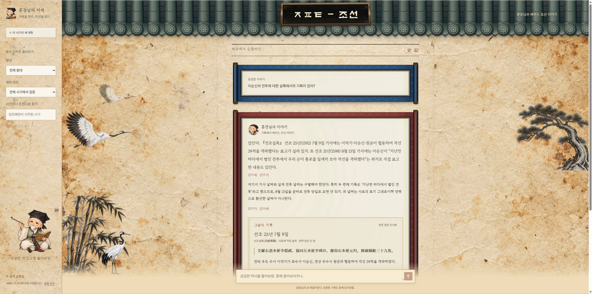

# Portfolio

프로젝트 포트폴리오 모음입니다.

## GPT-Joseon

조선시대 역사 질문에 관련 기록을 찾아 근거와 함께 답하는 RAG 기반 지식 서비스입니다.

- [프로젝트 소개 및 실행 방법](ai_pjt_2_gpt-joseon/README.md)
- [소스코드](ai_pjt_2_gpt-joseon/04_구현소스코드/)

## WON 아일랜드 | 우리은행 아이디어 경진대회

금융 사기 대응을 경영 시뮬레이션으로 연습하고, 부모·자녀의 금융교육 경험을 연결하는 서비스 제안입니다.

- [프로젝트 소개](won-island/README.md)
- [화면 목업 6개가 포함된 제안서 (PDF)](won-island/WON_Island_proposal_with_6_screens.pdf)
